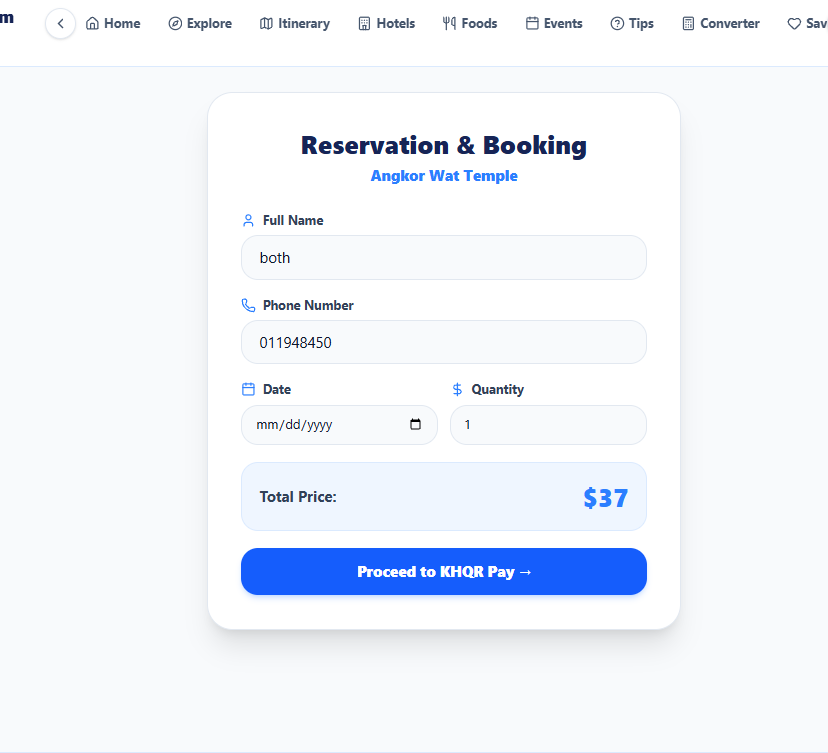
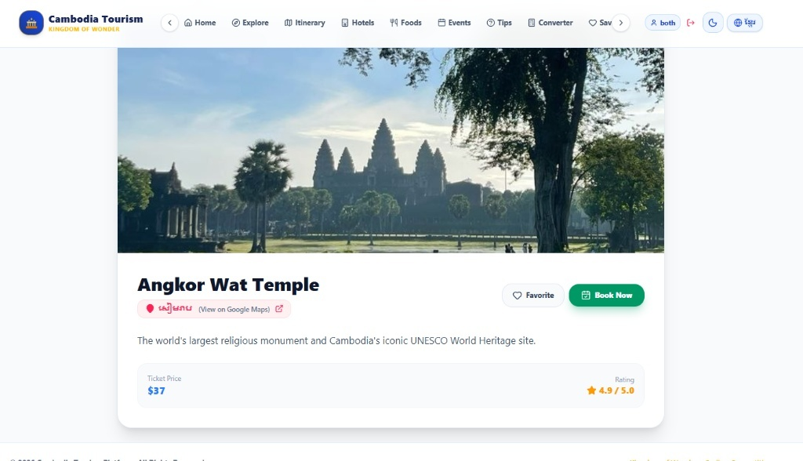

# 🇰🇭 Cambodia Tourism — Explore Kingdom of Wonder

[](https://react.dev/)
[](https://vitejs.dev/)
[](https://tailwindcss.com/)
[](https://developer.mozilla.org/en-US/docs/Web/API/Window/localStorage)
[](https://github.com/virakbothchharn6-tech/cambodia-tourisam)

> Interactive, modern, and high-performance tourism web platform promoting Cambodia's cultural landmarks, ecotourism, travel itineraries, and automated reservation management. Built with **React 18 & Vite**, styled with **Tailwind CSS**, state-persisted via **Browser LocalStorage**, and co-engineered using modern **AI-augmented development workflows**.

---

## 📸 Screenshots & UI Previews

| Hero Video Banner (Light Mode) | Hero Video Banner (Dark Mode) |
| :---: | :---: |
|  |  |

| Destination Catalog & Details | Tourist & Admin Authentication |
| :---: | :---: |
|  |  |

| Ticket Reservation & Booking | ACLEDA / Bakong KHQR Checkout |
| :---: | :---: |
|  |  |

| AI Concierge Assistant (Telegram Bot) | Booking Details & Confirmation |
| :---: | :---: |
|  |  |

| Telegram Concierge Contact | Khmer Localization Interface |
| :---: | :---: |
|  |  |

---

## 🤖 Co-Engineered with AI

This project was built leveraging a modern **AI-Assisted Engineering Workflow**:
* **Scaffolding & Architecture:** Prompt-driven modular components across routes, views, and shared UI states.
* **Complex State & Persistence:** Utilizing browser `localStorage` for zero-setup, stateful bookings and user authentication sessions without requiring an initial dedicated backend server.
* **Bilingual Localization:** Generating accurate, synchronized Khmer and English UI text and date formatting.
* **Component Optimization:** Streamlined Tailwind CSS utility styling for seamless dark/light theme switching and responsive screen layouts.

---

## ✨ Features

- 🏛️ **Iconic Destination Discovery**: Interactive showcase of Cambodia's cultural landmarks (Angkor Wat, Koh Rong, Bokor National Park, etc.) with ratings and entrance fees.
- 🎟️ **Direct Ticket Reservation**: Instant booking workflow with traveler contact inputs, visit date selection, and real-time pricing calculation.
- 💳 **KHQR Payment Simulation**: Realistic ACLEDA / Bakong QR checkout with instant payment acknowledgment modal.
- 🖨️ **PDF & Print Receipt Export**: Generate downloadable and printable digital booking receipts directly in-browser.
- 🤖 **Concierge Bot Widget**: Integrated customer support widget linking directly to Telegram concierge agents (`@UI_xnma`).
- 🔐 **Dual Auth Flow (Tourist / Admin)**: Mock authentication allowing tourists to manage saved bookings and admins to review platform reservations via `localStorage`.
- 🌓 **Theme & Language Switcher**: Smooth toggle between Light and Dark aesthetics, alongside instant Khmer/English bilingual support.

---

## 🛠️ Tech Stack & Architecture

| Layer | Technology |
|---|---|
| **Frontend Framework** | React 18 (Hooks, Dynamic Props, Modular Components) |
| **Tooling & Bundler** | Vite (Hot Module Replacement) |
| **Styling & Icons** | Tailwind CSS & Lucide React |
| **Data Persistence** | Browser `localStorage` (Client-side JSON state storage) |
| **Document Export** | Native Browser Print API & PDF Rendering |
| **Integrations** | Static KHQR Payment Simulator & Telegram Deep-Link |

---

## 📂 Project Structure

```text
cambodia-tourisam/
├── src/
│   ├── components/       # Navigation bars, modals, cards, and concierge chat
│   ├── data/             # Static destinations, itineraries, and festival datasets
│   ├── pages/            # Views (Home, Explore, Booking, Detail, Admin, Login)
│   ├── assets/           # Logos, icons, and theme styles
│   ├── App.jsx           # Application routing and state management
│   └── main.jsx          # Root React entry point
├── docs/screenshots/     # UI preview assets for README
├── public/               # Public assets and favicon
├── vite.config.js        # Vite bundler configuration
└── README.md

## 🚀 Getting Started (Local Setup)

### Prerequisites

[](https://nodejs.org/)
[](https://git-scm.com/)
[](https://vitejs.dev/)

---

### Quick Setup Commands

```bash
# 1. Clone the repository
git clone [https://github.com/virakbothchharn6-tech/cambodia-tourisam.git](https://github.com/virakbothchharn6-tech/cambodia-tourisam.git)
cd cambodia-tourisam

# 2. Install dependencies
npm install

# 3. Start development server
npm run dev